# To-Do Application Architecture

> **Status: APPROVED for planning — 2026-10-22.**
>
> **Source of truth:** [`requirements.md`](requirements.md), approved 2026-10-22. Questions Q7–Q9 are acknowledged and remain OPEN; this document does not resolve them.
>
> **Scope:** Architecture for the approved local-use MVP only. No production code or tests are specified as completed by this document.

## 1. Context and repository findings

### Observed repository facts

- This repository is an Agentic SDLC kit and contains project documentation and `.github` agent/instruction/skill files.
- At inspection, no application source tree, package manifest, database schema, migration, or application test suite was present. Therefore, no implemented application stack or runtime interfaces were found.
- `README.md` recommends React + Vite, Node.js + Express, SQLite, and Vitest **if starting from an empty repository**, and explicitly calls these recommendations rather than existing-stack facts.
- The prior `architecture.md` draft also suggested those technologies, but did not represent an approved architecture.
- The user selected the implementation stack after architecture approval on 2026-10-22; no application code or dependencies were present at that time.

### Recommendation labels

- **Existing:** confirmed in the repository as a fact.
- **Approved:** explicitly included in the human-approved requirements.
- **Proposed:** a design choice for review; it is not an implementation fact or human-approved stack decision.

### System context and boundary

The MVP is a local personal task application used by one local user. The browser UI, local application service, and task store are inside the proposed local runtime boundary. There is no account service, shared tenancy, cloud deployment, notification service, attachment store, or external integration in approved scope.

**Approved boundary constraints:** local development and use; no authentication, multiple users, or roles; current desktop Chrome is the initial compatibility target. Other browser/mobile support, availability and quantitative performance targets are OPEN (Q7).

## 2. Proposed architecture and data flow

The diagram is a **proposed logical architecture**, not a statement of components already implemented. React/Vite, Node/Express, SQLite, and Vitest were selected by the user for implementation on 2026-10-22. They are approved choices, not existing repository components.

```mermaid
flowchart LR
    User[Local user]
    Browser[Desktop Chrome<br/>Approved: React + Vite UI]
    API[Local HTTP API<br/>Approved: Node.js + Express]
    Service[Task application service<br/>Validation and business rules]
    Repo[Task repository<br/>Parameterized persistence operations]
    DB[(Local task database<br/>Approved: SQLite)]

    User -->|interacts with| Browser
    Browser -->|same-machine HTTP/JSON| API
    API -->|validated command/query| Service
    Service -->|transactional repository call| Repo
    Repo -->|SQL| DB
    DB -->|task data/result| Repo
    Repo --> Service
    Service --> API
    API -->|JSON result or error| Browser
    Browser -->|render list, detail, validation, confirmation| User
```



### Typical data flow

1. The user enters task fields or selects a filter in the browser UI.
2. For a write, the UI sends a JSON request to the local API. The UI may provide immediate usability feedback, but the task service/API is the authoritative validation boundary.
3. The API parses the request and delegates task rules to the task service. The service trims and validates user fields according to approved rules before persistence.
4. The repository uses parameterized database operations. A successful mutation is committed atomically; the resulting task is returned to the API.
5. The UI updates from the response or reloads the relevant list/detail data. Errors are presented without exposing internal exception details.
6. For deletion, the UI obtains confirmation before issuing the permanent-delete request. Confirmation is a UI interaction, not a reversible-delete or retention mechanism.

For reads, the task service requests a list with the selected approved filter and newest-created-first ordering, or retrieves a task by identifier. Missing task reads and writes are mapped to the specified 404 response.

## 3. Components and responsibilities

| Component | Responsibilities | Status / notes |
|---|---|---|
| Browser UI | Task list and detail display; All/Pending/Completed filter controls; create/edit form; completion control; priority/date controls; delete confirmation; validation/error feedback. Visually distinguish completed tasks. | React + Vite is the approved technology choice. List fields are title, completion, priority, and due date; detail shows all available fields including description and creation date. Empty lists show “No tasks yet”; successful create shows “Task created.” |
| Local HTTP API | Expose task operations; parse requests; translate service results to HTTP status and response bodies; consistently map invalid input and missing tasks. | API boundary is an architectural proposal; approved requirements specify HTTP 400/404 behavior for invalid/missing task operations. |
| Task application service | Apply field normalization, validation, defaults, list filtering/order, and lifecycle rules; coordinate persistence calls. | Proposed separation of business rules from transport and persistence. |
| Task repository | Encapsulate task reads/writes; use parameterized queries; perform mutation operations through transactions; handle persistence mapping. | Repository abstraction is proposed; SQLite is the approved database choice, not yet implemented. |
| Local persistence | Retain task records locally until user deletion; store date-only values without timezone conversion. | Local retention and SQLite selection are approved; SQLite is not yet implemented. |
| Local runtime/configuration | Start the UI and API on the same machine; serve from one local origin; bind the API to loopback and apply the approved origin protections. | Runtime configuration is proposed; same-origin and loopback direction was selected for DR-001. |

**Not included in MVP:** authentication/identity provider, roles, multi-user ownership, cloud services, reminders/notifications, attachments, telemetry service, or a separate audit-event history. These exclusions follow approved scope, not a claim that such capabilities exist.

## 4. API boundary and approved contracts

The create/list/read/delete routes, response envelopes/statuses, identifier, and list scope below were approved by the user on 2026-10-22. Edit and completion-write contracts remain unresolved and are not selected here.

| Proposed operation | Representative contract | Required behavior |
|---|---|---|
| List tasks | `GET /api/tasks?status=all\|pending\|completed` | Omitted status defaults to `all`; return all matching results without pagination, newest-created-first. No search or additional sort. Invalid status returns `400`. |
| Read task | `GET /api/tasks/{id}` | Existing task returns `200` with `{ "data": { ... } }`. Missing or malformed ID returns `404` with `Task not found`. |
| Create task | `POST /api/tasks` with JSON `{ "title": "...", "description": "...", "priority": "Low\|Medium\|High", "dueDate": "YYYY-MM-DD" }` | `description`, `priority`, and `dueDate` are optional; absent/trimmed-empty description is `""`; duplicate titles are allowed. A new task starts incomplete and defaults to Medium. Return `201`, a `Location` header, and `{ "data": { ... } }`. |
| Edit task | Proposed `PATCH /api/tasks/{id}` | Existing task can be edited and changes persist on subsequent read; missing task returns `404` / `Task not found`. Whether updates are partial or full, which fields can be edited, and conflict behavior are OPEN (Q9). `PATCH` does not settle those semantics. |
| Change completion | Could be a field in the proposed edit operation or a separate completion operation. | Must allow complete and pending states and persist them. The endpoint shape and completion timestamp/side effects remain OPEN where not established by requirements (Q9). |
| Delete task | `DELETE /api/tasks/{id}` | The UI asks for confirmation before calling this operation. For an existing task, deletion is permanent and returns `204 No Content`. Missing or malformed ID returns `404` / `Task not found`. |

### Approved response/error shapes

The user approved these response envelopes on 2026-10-22:

```json
{ "data": { "id": "uuid-v4", "title": "Example", "completed": false } }
```

```json
{ "error": { "message": "Validation failed", "fields": { "title": "..." } } }
```

```json
{ "error": { "message": "Task not found" } }
```

- Invalid API input returns HTTP `400` with the validation envelope above. Missing tasks return HTTP `404` with the exact message `Task not found`.
- List responses use `{ "data": [...] }`; create/read use `{ "data": { ... } }`. Delete returns `204` without a response body.
- A generic non-sensitive response is recommended for unexpected server failures; avoid returning stack traces or filesystem/database details. Exact status and envelope for other failures remain unapproved.

## 5. Conceptual data model and validation

No schema currently exists in the repository. The following is a **proposed conceptual model**, limited to concepts needed to satisfy the approved stories:

### Task

| Conceptual attribute | Proposed representation / rule | Requirement relationship |
|---|---|---|
| `id` | Server-generated UUID v4. | Approved 2026-10-22; needed to inspect, edit, complete, and delete a task. |
| `title` | Required text, trimmed at both ends; 1–100 characters after trimming. | Approved P-US-01 / P-BR-01. |
| `description` | Optional text, trimmed at both ends; maximum 1,000 characters after trimming. If omitted or empty after trimming, store and return `""`. | Approved P-US-01 / P-BR-01; representation approved 2026-10-22. |
| `completed` | Boolean; default `false`. | Approved P-US-05. |
| `priority` | Optional input; stored value is Low, Medium, or High; default Medium. | Approved P-US-06. |
| `dueDate` | Optional date-only value in `YYYY-MM-DD`; preserve as a calendar date, with no timezone conversion; past dates are valid. | Approved P-US-06. |
| `createdAt` | UTC ISO-8601 timestamp at fixed millisecond precision (`YYYY-MM-DDTHH:mm:ss.sssZ`), needed to implement newest-created-first ordering. | Representation approved 2026-10-22; equal-timestamp ordering remains unspecified. |
| `updatedAt` | Proposed last-modified timestamp, useful for persistence/diagnostics; whether required or exposed is not specified. | Recommendation only; not a stated requirement. |

Conceptual relationship: one task record contains its own fields; the approved MVP has no user/account entity or ownership relationship. Duplicate titles are allowed. IDs are server-generated; clients do not supply IDs or timestamps. No completion timestamp is added unless a later decision specifies one (Q9).

### Validation boundary

The service/API must validate submitted values even if the UI also validates them. For create and any future update contract:

1. Trim leading and trailing whitespace from title before testing it. Reject missing, blank-after-trim, or over-100-character titles; accept only 1–100 characters after trimming.
2. If description is supplied, trim outer whitespace and reject more than 1,000 characters after trimming. If omitted or empty after trimming, store and return the empty string `""`.
3. Use Medium when priority is omitted on creation; accept only Low, Medium, or High when supplied. Invalid values return HTTP 400.
4. If a due date is supplied, require exact date-only `YYYY-MM-DD` format and a real calendar date; do not reject past dates or apply timezone conversion. Invalid values return HTTP 400.
5. New tasks default to incomplete. Validate completion values/types on requests that change completion; exact invalid-type response details follow the general 400 rule where the request is invalid.
6. Duplicate titles are allowed. Reject unknown fields in create requests with HTTP `400` and a clear validation error. Other cross-field rules remain unspecified.

Count title and description lengths as Unicode code points after trimming. Use this convention consistently in server validation and tests; the character limits themselves remain as approved.

## 6. Authentication, roles, and security boundary

- **Approved:** local use only for MVP; no authentication, multiple users, or roles. There is no role-authorization matrix and no account identity against which to apply ownership checks.
- Consequently, task access is limited by the local application boundary, not by per-user authorization. This design must not claim that it provides multi-user isolation.
- **Proposed security boundary:** bind the API to loopback and serve the UI and API from the same intended local origin. Do not expose the API to a network by default. Reject unexpected `Host` and browser `Origin` values, do not enable permissive CORS, and protect state-changing requests with origin checks and an appropriate JSON content type. The user selected this architectural direction in response to DR-001; implementation details remain proposed until implemented and tested.
- Validate all API input at the service boundary, use parameterized persistence operations, and avoid placing user-entered task content in logs.
- Local data protection relies on the host operating system and the user's local environment in this proposal. No encryption-at-rest, backup, or secure-erasure guarantee is specified; formal backup, retention, and secure-deletion questions remain OPEN (Q8).
- No passwords, payment details, or other sensitive personal information should be intentionally collected. No separate audit trail is required.

These controls are scoped recommendations, not new authentication or privacy requirements.

## 7. Concurrency, atomicity, and consistency

Approved behavior requires edits/completion changes to persist on subsequent reads and deletion to be permanent. It does not specify concurrent-update conflict behavior (Q9).

### Proposed baseline

- Use a single local service process and SQLite. Use a transaction for each logical mutation so a write is committed wholly or not at all; use parameterized statements for all user-controlled values.
- Serialize or rely on the database's transaction/locking behavior for writes; surface a controlled persistence error if the database remains unavailable/busy rather than reporting an uncommitted mutation as successful.
- Return mutation success only after commit. Refresh/update UI state from the committed response (or re-read) so it does not present unpersisted changes as durable.
- A transaction provides atomicity of an individual mutation, but does not by itself define how two separately submitted edits to the same task should be reconciled.

### Unresolved conflict decision (Q9)

Possible approaches include:

1. **Last write wins:** simpler client/API contract, but a stale form may overwrite another edit.
2. **Optimistic concurrency:** include a version/ETag and reject stale writes (for example, with a conflict response); safer against silent overwrite but adds state and UI conflict handling.
3. **No explicit conflict handling:** accept datastore/order-of-write behavior, with a documented risk of lost updates.

Do not select among these from this architecture. The human/product decision on update-conflict behavior is still OPEN. If the MVP is explicitly single-process and single-local-user, concurrent writes may be uncommon, but browser tabs or overlapping requests are still possible and should not be mistaken for impossible.

## 8. Errors and observability

### Required error behavior

- Invalid API input: HTTP `400` and a clear validation message.
- Missing task on read/edit/delete: HTTP `404`, message exactly `Task not found`.
- The UI should present understandable validation and operation feedback, without changing approved status/message behavior. Create success and empty-list feedback are approved; presentation of other operation failures remains unspecified.

### Proposed handling and diagnostics

- Centralize API error mapping so known validation and not-found conditions are stable and persistence/internal failures do not leak implementation details.
- Log operational events and errors locally (for example, startup/shutdown and failure category), but not full descriptions or unnecessary user-entered content. Do not add remote telemetry.
- Include enough non-content context to diagnose local failures, such as operation category and error class; do not log secrets or database contents.
- No separate audit history is required. Retention/rotation policy and formal observability/availability targets are not specified.
- Handle database unavailable, disk full, and unexpected failures with a generic user-facing failure and useful local diagnostic. Exact status/retry behavior is an implementation decision pending API contract agreement.

## 9. External integrations

No external integrations are included in approved MVP scope. The proposed runtime needs no identity provider, cloud database, notification provider, attachment service, or third-party telemetry. The browser is the client platform, not a remote service integration.

Adding any external service would expand scope and require a separate product/security decision.

## 10. Deployment, configuration, and secrets

### Proposed local deployment

- Run the UI and API on the user's machine; target current desktop Chrome initially.
- Serve the built UI and API from one local origin. Bind the API to loopback, not all network interfaces. Validate expected `Host` and browser `Origin` values, reject unexpected origins, do not enable permissive CORS, and require the intended JSON request format for state-changing requests. This direction was selected by the user for DR-001 on 2026-10-22; implementation details and tests remain for the implementation stage.
- Store the database at `%LOCALAPPDATA%\ToDoApplication\data.sqlite`; if `LOCALAPPDATA` is unavailable, use the user's `AppData\Local\ToDoApplication\data.sqlite` directory. An optional `TODO_DB_PATH` override must resolve to an absolute path. Keep the file outside the repository and transient build/output directories.
- Use versioned SQL migrations. Apply pending migrations transactionally before accepting requests; fail startup rather than silently resetting data if migration fails. Close the database cleanly on shutdown. No backup/recovery or secure-erasure guarantee is implied.
- Preserve task data between normal app restarts. Delete records only through the confirmed permanent-delete flow; this does not imply secure erasure from storage media or backups.
- Do not claim support for cloud deployment, other browsers, mobile, availability, performance, or backup/recovery levels that are OPEN in Q7/Q8.

### Configuration and secrets

- No secret or credential is needed for the approved local-only design. Do not introduce credentials, API keys, or `.env` secrets without a justified future integration.
- Configuration may include local bind/port and database location. Keep defaults local-only and document any override; do not make remote exposure an accidental default.
- The repository's `.gitignore` already excludes `.env` and related local environment files; this is an **existing repository fact**, not evidence of a configured application runtime or of secrets currently being used.
- Protect local database files through normal operating-system permissions. Encryption, backup, retention, and secure deletion remain unresolved and must not be represented as guaranteed.

## 11. Technology recommendations and alternatives

| Concern | Recommendation | Label / alternatives and trade-offs |
|---|---|---|
| UI | React + Vite, JavaScript | **Approved by user 2026-10-22**. Beginner-friendly and separates UI from API; adds a frontend toolchain. Alternatives include a small server-rendered or plain HTML/JS UI with fewer tools but less component structure. No UI framework is currently present. |
| API/runtime | Node.js + Express REST API | **Approved by user 2026-10-22**. Familiar HTTP boundary and clear validation/error middleware; creates a separate runtime/process boundary. A single-process server-rendered application could be simpler, but would couple UI and backend differently. No Node application or Express dependency is present. |
| Persistence | SQLite local database | **Approved by user 2026-10-22**. Durable local storage and transactions without a separate database service; requires schema/migration and local-file lifecycle decisions. JSON/file storage is simpler initially but has weaker concurrent-write and transactional behavior; a server database is unnecessary complexity for approved local single-user scope. No database is present. |
| Tests | Vitest | **Approved by user 2026-10-22**. No test suite or test dependencies were present at inspection. |
| Packaging | Local development/start scripts first; decide packaging later | **Proposed**. A browser-based local app aligns with current desktop Chrome target; whether to distribute as a desktop installer or require a local development command is not specified. Avoid selecting installer technology until clarified. |

| API and response contract | Approved create/list/read/delete routes, filters, success statuses, and response envelopes | **Approved by user 2026-10-22**. Edit and completion-write contracts remain open. |
| IDs and validation details | UUID v4 IDs; Unicode code-point counting | **Approved by user 2026-10-22**. |
| Local data lifecycle | `%LOCALAPPDATA%\ToDoApplication\data.sqlite`, `TODO_DB_PATH` override, versioned transactional migrations, fail startup on migration error | **Approved by user 2026-10-22**; backup/recovery and secure deletion remain open. |
| Task-list interaction details | Allow duplicate titles; no pagination; defined list/detail fields; “No tasks yet” and “Task created” messages | **Approved by user 2026-10-22**. |

Approved choices are not yet implemented; exact package versions and remaining project configuration are implementation details.

## 12. Key decisions, alternatives, and risks

| Topic | Current position | Alternatives / trade-off / risk |
|---|---|---|
| Local single-user boundary | Approved local-only MVP; no auth, users, or roles. | Adding network/multi-user use would require identity, authorization/ownership, and threat-model decisions. The proposed loopback binding limits exposure but is not a substitute for auth if scope changes. |
| Data persistence | SQLite is approved but not yet implemented. | SQLite keeps deployment local and transactional; file-based JSON reduces setup but complicates atomic concurrent updates; server DB adds operational burden. Backups/secure deletion remain OPEN. |
| Permanent deletion | Approved permanent deletion only after confirmation. | Confirmation reduces accidental deletes but offers no undo. Soft-delete/undo would contradict the approved permanent-delete behavior unless requirements change. Storage-media secure deletion is not guaranteed. |
| Due dates | Approved date-only ISO string; past dates allowed. | Store as date-only text/value and avoid timezone conversion. Converting to timestamp can shift calendar date; do not do so. Locale display formatting is not specified. |
| Priority default | Approved Medium. | Do not introduce a different default or inferred priority ranking behavior. |
| List ordering | Approved newest-created-first and All/Pending/Completed filters; return all matching tasks without pagination. | Equal-timestamp ordering is unspecified; do not present a tie-breaker as a requirement. |
| Concurrent edits | Atomic individual writes recommended; cross-request conflict policy OPEN. | Last-write-wins is simpler but risks lost edits; optimistic concurrency is safer but requires version state and conflict UX. |
| Error contract | Required 400 and 404 cases; remaining response shapes are open. | Consistent JSON envelopes improve clients but are proposals. Do not leak stack traces or storage details. |
| Quality targets | Current desktop Chrome is initial target; quantitative performance, accessibility, availability, other browser/mobile targets OPEN. | Do not set invented thresholds. Obtain decisions before treating these as acceptance criteria. |

## 13. Open decisions and risks (not resolved here)

The following questions are explicitly left OPEN as approved in `requirements.md`:

- **Q7 — Platform and quality:** measurable performance, formal accessibility conformance, availability, other browsers, mobile compatibility, and quantitative quality targets.
- **Q8 — Privacy and data lifecycle:** formal retention, backup/recovery, and secure-deletion requirements.
- **Q9 — Task interactions:** editable fields and partial versus full update semantics; omitted/null update handling; update-conflict behavior; completion write shape and timestamps/side effects; and independent priority/due-date editing.

Remaining implementation details include exact package versions, schema field types/indexes, migration file naming, and response behavior for non-required server failures. These do not change the approved route/error contract or business behavior; do not treat a recommendation as an approved requirement.

## 14. Requirement-to-component traceability

The identifiers and approved behavior below come from `requirements.md`. Component/API mappings are proposed architecture, not implementation evidence.

| Requirement | Approved behavior / constraint | Proposed components and interfaces |
|---|---|---|
| **P-US-01 — Create a task** | Create with title and optional description; title trimmed and 1–100 characters; optional description trimmed and max 1,000; invalid priority/date rejected with HTTP 400. | Browser form; API `POST /api/tasks`; task service normalization/validation; repository create transaction. |
| **P-US-02 — View and inspect tasks** | List defaults to all, newest-created-first; All/Pending/Completed filters; inspect a task; missing task is `404` / `Task not found`. | Browser list/detail and filter control; API `GET /api/tasks` and `GET /api/tasks/{id}`; task service filter/order; repository query. |
| **P-US-03 — Edit a task** | Edits to existing task persist on subsequent read; missing task is `404` / `Task not found`. Update shape, editable fields, and conflict behavior are OPEN. | Browser editor; proposed API `PATCH /api/tasks/{id}` (contract remains open); task service; transactional repository update and subsequent read. |
| **P-US-04 — Delete a task** | Permanent deletion only after user confirmation; missing task is `404` / `Task not found`. | Browser confirmation; proposed API `DELETE /api/tasks/{id}`; task service and atomic repository delete. No soft-delete/undo. |
| **P-US-05 — Mark complete or pending** | New task defaults incomplete; complete/pending change persists; completed tasks are visually distinguished and filters apply. Completion timestamp/side effects are OPEN. | Browser completion control/list rendering; API write boundary (exact operation open); service state validation; repository mutation. |
| **P-US-06 — Assign priority and optional due date** | Optional Low/Medium/High priority defaults Medium; optional valid date-only ISO `YYYY-MM-DD`; past dates allowed; invalid input returns HTTP 400. | Browser controls; API create/update validation; task service and conceptual `priority`/`dueDate` fields; repository storage without timezone conversion. |
| **P-BR-01 — Business rules and validation** | Approved trimming/length, priority/default, date-only/calendar, and 400/404 rules; server-side validation and parameterized queries are source guidance. | Task service as authoritative validator; API status mapping; repository parameterized queries. |
| **P-ERR-01 — Errors** | Invalid API input is HTTP 400 with clear message; missing task is HTTP 404 with `Task not found`; other error handling is unspecified. | API error mapping; task service error categories; UI feedback; local operational logging that excludes full descriptions/unnecessary user content. |
| **P-NFR-01 — Non-functional requirements** | Local use; current desktop Chrome initial target; no specified measurable performance/accessibility/availability target; Q7/Q8 items remain open. | Local runtime/configuration and browser UI; proposed loopback API and local persistence. No quantitative target or cloud/backup claim is added. |

## 15. Approval and decision record

- **Requirements baseline:** approved 2026-10-22; Q7–Q9 remain OPEN.
- **Architecture status:** **APPROVED for planning — 2026-10-22**; this approval does not authorize implementation.
- **Technology selection:** React + Vite (JavaScript), Node.js + Express, SQLite, and Vitest were approved by the user on 2026-10-22. They are not existing repository components; exact package versions and configuration remain implementation details.
- **Implementation evidence:** no application implementation or tests were present at inspection; this document does not claim either exists or has been verified.

### Decision history

| Date | Reference | Human decision | Architecture response |
|---|---|---|---|
| 2026-10-22 | DR-001 | Adopt the recommended same-origin UI/API deployment and restrictive local-origin protections. | Updated §§6 and 10 to specify loopback binding, expected `Host`/`Origin` validation, no permissive CORS, and origin/content-type protections for state-changing requests. This resolves the design direction only; implementation and verification remain outstanding. |
| 2026-10-22 | Architecture approval | Approve the architecture and proceed to Planning. | User approved this architecture for the Planning stage. Implementation still requires the separate human approval gate after `impl-plan.md`. |
| 2026-10-22 | Technology selection | Approve React + Vite (JavaScript), Node.js + Express, SQLite, and Vitest. | Updated §§2, 3, 11, 12, and 15. Exact package versions and project configuration remain to be selected; Q9-dependent edit/completion behavior remains blocked. |
| 2026-10-22 | TASK-001 contracts | Approve create/list/read/delete HTTP contracts, UUID v4, Unicode code-point counting, Windows SQLite path/lifecycle, UTC timestamp representation, duplicate-title behavior, list/detail fields, empty/success messages, empty description as `""`, and no pagination. | Updated §§3–5, 10–15. Edit/update and completion-write semantics and same-task conflict behavior remain OPEN. |
| 2026-10-22 | Unknown create fields | Reject fields not defined by the create contract with HTTP `400` and a clear validation error. | Updated §5. |
